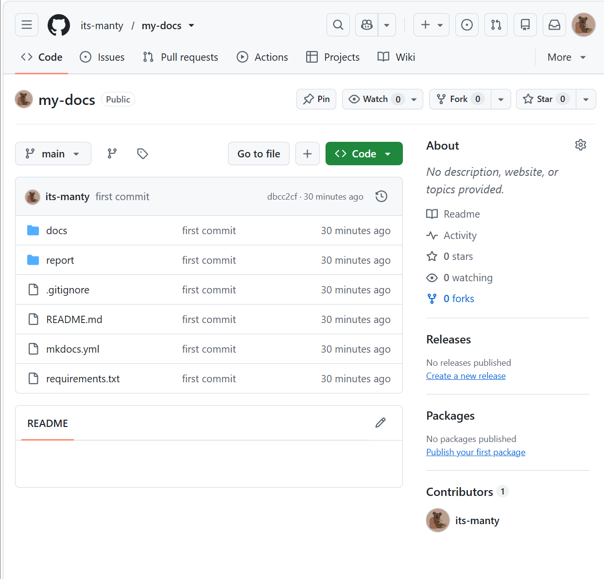
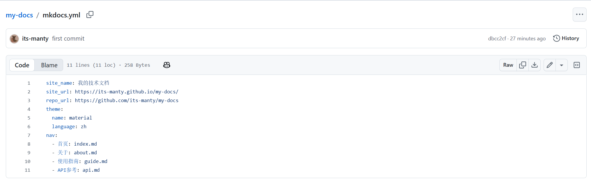
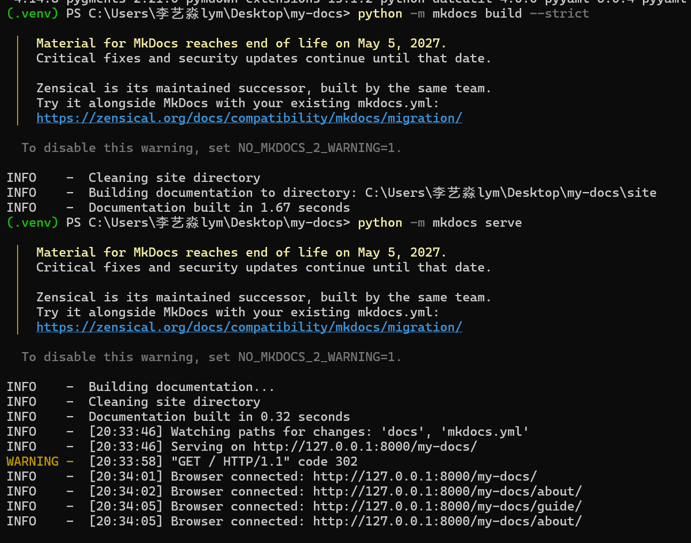
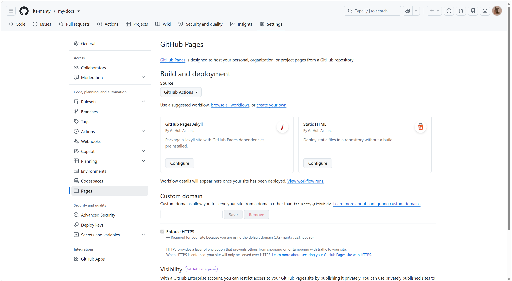
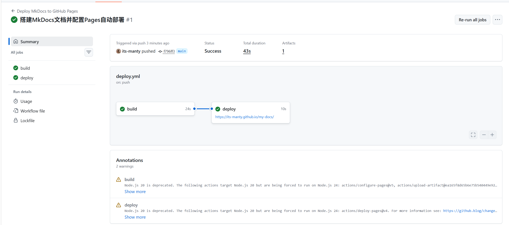
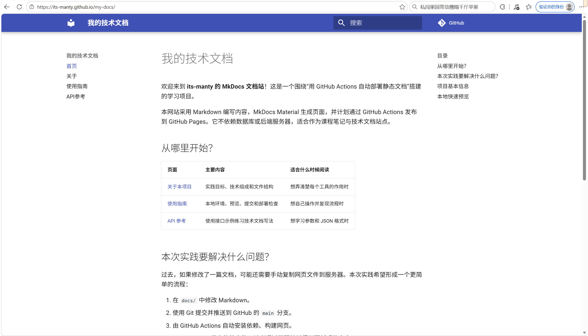

# 实践项目 2：个人实验报告

## 1. 基本信息

| 项目 | 内容 |
| --- | --- |
| 实践名称 | 通过 GitHub Actions 自动部署静态文档到 GitHub Pages |
| GitHub 登录名 | `its-manty` |
| 个人源码仓库 | [https://github.com/its-manty/my-docs](https://github.com/its-manty/my-docs) |
| 个人作业报告 | [report/README.md](https://github.com/its-manty/my-docs/blob/main/report/README.md) |
| 最终网站地址 | [https://its-manty.github.io/my-docs/](https://its-manty.github.io/my-docs/) |
| 文档工具 | Markdown、MkDocs、Material for MkDocs |
| 自动化与托管 | GitHub Actions、GitHub Pages |
| 本地环境 | Windows PowerShell、Python 虚拟环境 |

本次实践的目标是使用 Markdown 编写四页技术文档，通过 MkDocs 将文档构建为静态网页，再使用 GitHub Actions 在推送代码后自动构建、发布到 GitHub Pages，并通过第二次推送验证自动更新功能。

## 2. 实践过程与关键截图

### 2.1 创建个人公开仓库

**操作过程：** 在个人 GitHub 账号 `its-manty` 下创建 `my-docs` 仓库，设置为 **Public**，采用 `main` 作为默认分支，并将本地项目文件推送至远程仓库。

**为什么这样做：** GitHub 仓库用于统一保存文档源文件、构建配置和工作流，Public 仓库则便于教师公开查看项目结构、提交记录及实验成果。

**操作结果：** 截图中可看到仓库名称、账号、`Public` 标识和 `main` 分支，说明个人公开仓库已建立。



*图 1：`its-manty/my-docs` 公开仓库首页。*

### 2.2 项目结构与 MkDocs 配置

**操作过程：** 在 `docs/` 目录中编写四个 Markdown 文档页面：`index.md`（首页）、`about.md`（关于）、`guide.md`（使用指南）和 `api.md`（API 参考）。项目根目录使用 `mkdocs.yml` 配置网站名称、Material 主题、中文界面和四页导航，`requirements.txt` 指定 Python 依赖。

项目中的关键目录和文件如下：

```text
my-docs/
├── .github/workflows/deploy.yml  # GitHub Actions 工作流
├── docs/
│   ├── index.md                  # 首页
│   ├── about.md                  # 关于页
│   ├── guide.md                  # 使用指南
│   └── api.md                    # API 参考
├── report/
│   ├── README.md                 # 本实验报告
│   └── images/                   # 实验截图
├── mkdocs.yml                    # 网站配置与页面导航
├── requirements.txt              # MkDocs 依赖
├── .gitignore                    # 忽略本地产物
└── README.md                     # 仓库简介
```

**为什么这样做：** 将正文放在 `docs/` 便于修改与维护；`nav` 用于规定导航菜单及页面顺序；`site/` 是 MkDocs 构建后自动生成的产物，通常无需将其提交到 `main` 分支。

**操作结果：** `mkdocs.yml` 中的导航配置包含四页，主题设置为 Material。



*图 2：GitHub 中的 `mkdocs.yml` 配置文件，显示 `theme` 和 `nav` 等关键配置。*

### 2.3 本地构建与预览

**操作过程：** 在 Windows PowerShell 中进入本地仓库根目录，建立并激活 Python 虚拟环境，然后安装依赖，执行构建和预览命令。

```powershell
python -m venv .venv
.\.venv\Scripts\Activate.ps1
python -m pip install -r requirements.txt
python -m mkdocs build --strict
python -m mkdocs serve
```

**为什么这样做：** 虚拟环境将项目依赖与系统 Python 环境隔离；`mkdocs build --strict` 检查页面构建情况；`mkdocs serve` 启动本地服务器，便于在正式发布前检查页面和导航。

**操作结果：** 截图显示严格构建成功，MkDocs 在本地启动了预览服务，浏览器访问记录包含项目页面。



*图 3：PowerShell 中 `mkdocs build --strict` 运行成功，以及 `mkdocs serve` 的服务与访问记录。*

### 2.4 设置 GitHub Pages 发布来源

**操作过程：** 在个人仓库中进入 **Settings → Pages → Build and deployment**，将 **Source** 设置为 **GitHub Actions**。

**为什么这样做：** 此配置让 GitHub Pages 接收 Actions 工作流发布的构建产物，而不是从特定分支直接读取源码；本实验无需手工创建 `gh-pages` 分支。

**操作结果：** 截图中 `Source` 已选择 `GitHub Actions`。



*图 4：仓库 Pages 的 Build and deployment 设置。*

### 2.5 首次自动构建与部署

**操作过程：** 编写 `.github/workflows/deploy.yml`，在推送指定文档或配置文件到 `main` 分支时启动工作流。工作流的 `build` 任务安装依赖、执行 `mkdocs build --strict` 并上传 `site/`，随后 `deploy` 任务发布到 GitHub Pages。

**为什么这样做：** 将构建和部署过程自动化，能够减少重复操作，并在 Actions 中保留可追踪的运行状态。

**操作结果：** 首次工作流运行中，`build` 和 `deploy` 均为绿色成功状态，总运行时间约 43 秒。

- 首次工作流运行：[Deploy MkDocs to GitHub Pages #1](https://github.com/its-manty/my-docs/actions/runs/45026318864)
- 对应提交：[`f796ff3`](https://github.com/its-manty/my-docs/commit/f796ff3)



*图 5：首次 Actions 运行记录，`build` 和 `deploy` 均成功。*

### 2.6 公开网站效果与四页导航

**操作过程：** 在部署成功后，通过浏览器访问 GitHub Pages 网站，检查首页排版、内容显示及导航菜单。

**为什么这样做：** 工作流显示成功不代表所有网页内容和链接都完全符合预期，因此还需要通过浏览器检查网站效果。

**操作结果：** 截图显示公开网站的首页已正常加载，浏览器地址栏为 `https://its-manty.github.io/my-docs/`，页面中可见导航菜单、标题、简介、表格与正文。



*图 6：公开网站首页及页面导航。*

网站各页面地址：

| 页面 | 地址 |
| --- | --- |
| 首页 | [网站首页](https://its-manty.github.io/my-docs/) |
| 关于 | [关于本项目](https://its-manty.github.io/my-docs/about/) |
| 使用指南 | [使用指南](https://its-manty.github.io/my-docs/guide/) |
| API 参考 | [API 参考](https://its-manty.github.io/my-docs/api/) |

### 2.7 第二次推送与自动更新验证

**操作过程：** 在第一次部署成功后，对 `docs/index.md` 进行一次新的内容修改，添加：

```markdown
自动部署验证：这是我第二次推送后更新的内容。
```

随后将修改提交并推送到 `main` 分支，观察 GitHub Actions 是否在没有手动启动的情况下再次执行。

**为什么这样做：** 仅有一次成功部署不能证明“修改文档后自动更新”。第二次提交通过比较提交记录、Actions 运行状态与网站内容，验证 `push` 触发机制。

**操作结果：** GitHub Actions 中有两次成功运行记录，第二次运行由 `push` 触发，提交内容确实是在 `docs/index.md` 新增了验证文字。

- 第二次提交：[`ef3e09c`：验证文档修改后自动更新网站](https://github.com/its-manty/my-docs/commit/ef3e09c06462cb1b1a8369a7608f86d2f1c2455d)
- 第二次 Actions 运行：[Deploy MkDocs to GitHub Pages #2](https://github.com/its-manty/my-docs/actions/runs/45027274568)
- 最终网站：[https://its-manty.github.io/my-docs/](https://its-manty.github.io/my-docs/)


*图 7：Actions 列表中可见两次成功运行，第二次运行与修改文档的提交相对应。*


*图 8：第二次部署后的网站截图。*

## 3. 问题与解决

### 3.1 本地网址提示“拒绝连接”

最初已经创建并激活虚拟环境，但浏览器仍无法连接本地地址。原因在于激活虚拟环境只代表 Python 依赖环境已准备好，并不会自动启动 Web 服务。

**解决方式：** 安装依赖并运行 `python -m mkdocs serve`，保持终端中的服务进程运行；访问终端实际显示的本地地址及端口（通常为 `http://127.0.0.1:8000/`）。

### 3.2 在 GitHub 中找不到 Pages 的部署设置

开始时进入了个人账户级别的 Settings 页面，而不是 `my-docs` 仓库的 Settings 页面，因而看不到课程要求的 **Build and deployment** 选项。

**解决方式：** 返回 `my-docs` 仓库，进入仓库的 **Settings → Pages**，选择 GitHub Actions 作为 Source。

### 3.3 在 Settings 中找不到部署工作流

GitHub 仓库设置侧栏中的 Actions 是工作流设置，而顶部导航栏中的 Actions 才是查看工作流运行记录的页面。

**解决方式：** 从仓库顶部进入 Actions，查看 `Deploy MkDocs to GitHub Pages` 的运行列表、状态及工作流日志。

### 3.4 部署记录中的警告

首次成功运行记录包含 Node.js 版本弃用提示。该提示属于底层 Actions 依赖的兼容性提醒，不等同于构建失败。

**核对结果：** 首次和第二次运行均显示成功，`build` 与 `deploy` 的任务状态没有失败；因此未为了消除提示而随意修改配置。

## 4. 原理理解

### 4.1 `docs/` 和 `site/` 分别保存什么？为什么不用手工修改 `site/`？

`docs/` 保存项目的 Markdown **源码**，包括首页、关于、使用指南和 API 参考。`site/` 保存 MkDocs 根据 Markdown 和配置生成的 **静态网页产物**。如果直接修改 `site/`，下一次构建就可能覆盖这些修改，所以应修改 `docs/` 并重新构建。生成目录也不需要作为网站源码提交到 `main`。

### 4.2 本次工作流在什么情况下自动运行？

工作流监听推送到 `main` 分支的 `push` 事件，但只在此次推送涉及以下路径时自动运行：

- `docs/**`
- `mkdocs.yml`
- `requirements.txt`
- `.github/workflows/deploy.yml`

此外，`workflow_dispatch` 允许在 Actions 页面手动触发运行，但第二次自动更新验证使用的是 `push` 触发，并非手动部署。

### 4.3 `build` 与 `deploy` 两个任务有什么区别？

`build` 负责获取源码、设置 Python、安装依赖、将 Markdown 构建为网页并上传 `site/` 产物；`deploy` 负责在 `build` 成功后，将上传的静态网站产物发布到 GitHub Pages。工作流里的 `needs: build` 保证部署不会在构建成功之前开始。

### 4.4 只修改 `report/README.md` 会触发部署吗？为什么？

**不会自动触发本次工作流。** 因为 `report/README.md` 不属于 `push.paths` 指定的监控路径。报告文件的提交仍会出现在 Git 仓库中，但仅修改实验报告不会导致网站重新构建，这是符合本次配置的预期行为。

### 4.5 本次方案为什么不需要 `gh-pages` 分支？

本次采用的是 GitHub 官方 Pages Actions 工作流。构建任务将 `site/` 作为 artifact 上传，部署任务通过 `actions/deploy-pages` 发布；Pages 的发布来源也设置为 GitHub Actions。因此可以直接部署构建产物，不需要单独创建和维护 `gh-pages` 分支。

## 5. 实践总结

本次实践把 Markdown 编写、MkDocs 构建、Git 版本管理、GitHub Actions 自动化以及 GitHub Pages 网站发布连接为一个完整过程。实际操作中，我进一步区分了 Python 虚拟环境与本地服务器、个人账户设置与仓库设置、Actions 配置页与运行记录页，也理解了“成功推送代码”和“成功发布网站”不是同一件事。
